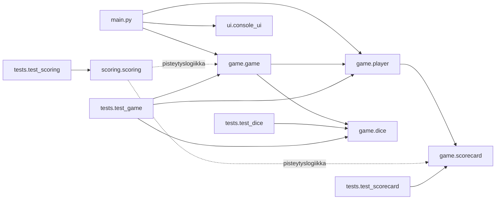
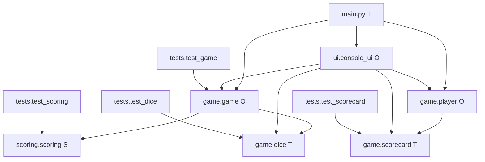
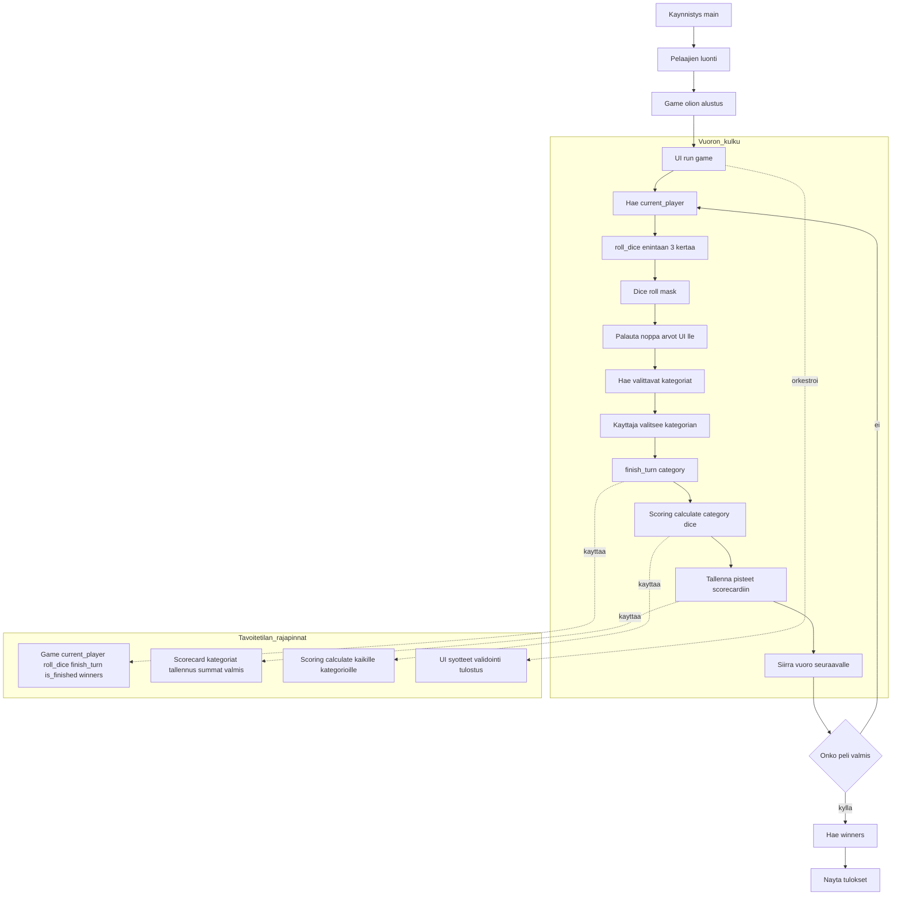
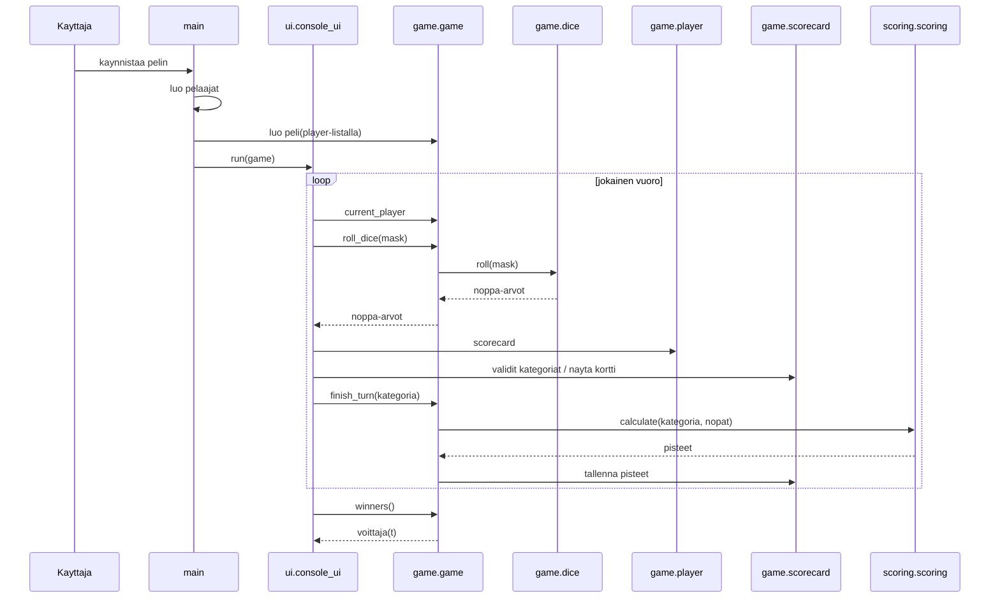

# Yatsi

Yatsi on Pythonilla toteutettava noppapeli. Peli käynnistyy komennolla `python main.py`.

## Projektin rakenne

```text
main.py                 Pelin käynnistyspiste
game/                   Pelin kulku, nopat, pelaaja ja pistetaulukko
scoring/                Pistekategorioiden laskenta
ui/                     Komentorivikäyttöliittymä
tests/                  Automaattiset testit
```

## Arkkitehtuuri ja kaaviot

### Moduuliriippuvuudet



### Toteutustila (T/O/S)

Merkinnat:
- T = toteutettu
- O = osittain toteutettu
- S = suunniteltu



### Tavoitetilan ajovirta


### Sekvenssikaavio


## Moduulien rajapinnat

Alla on sovittu rajapinta moduulien toteutuksille. `list[int]` tarkoittaa tässä viiden nopan arvoja väliltä 1–6. Pelilogiikka, nopat ja pistelasku eivät tulosta ruudulle tai kysy käyttäjältä syötteitä; siitä vastaa käyttöliittymä.

Kategorioiden nimet ovat `Ykköset` ("1s"), `Kakkoset` ("2s"), `Kolmoset` ("3s"), `Neloset` ("4s"), `Viitoset` ("5s"), `Kuutoset` ("6s"), `Pari` ("pair"), `Kaksi paria` ("2pair"), `Kolmoisluku` ("3oak"), `Neloisluku` ("4oak"), `Pieni suora` ("1-5"), `Suuri suora` ("2-6"), `Täyskäsi` ("FullH"), `Sattuma` ("misc") ja `Yatzy` ("yatzy").

### `game/dice.py`

`Dice` omistaa viisi noppaa. `vals` sisältää niiden nykyiset arvot. Pelin tulee heittää kaikki nopat ennen arvojen lukemista.

| Metodi tai arvo | Syöte | Palauttaa ja tekee |
| --- | --- | --- |
| `roll(mask="11111")` | Viiden merkin merkkijono: `1` heittää nopan, `0` säilyttää sen | `None`; päivittää valittujen noppien arvot. Virheellisestä maskista nostaa `ValueError`. |
| `vals` | Ei syötettä | Nykyiset viisi noppa-arvoa listana. |

Esimerkiksi `roll("01011")` heittää nopat 2, 4 ja 5. Maski annetaan jokaisella heittokerralla uudelleen, joten säilytysvalintoja voi muuttaa.

### `scoring/scoring.py`

Pistelasku on puhdasta logiikkaa: se ei muuta peliä eikä käsittele käyttöliittymää.

| Metodi | Syöte | Palauttaa ja tekee |
| --- | --- | --- |
| `calculate(category, dice)` | Kategorian nimi (`str`) ja viiden nopan arvot (`list[int]`) | Pisteet (`int`); kelvollinen mutta kategoriaan sopimaton yhdistelmä antaa `0`. Tuntemattomasta kategoriasta tai virheellisistä noppa-arvoista nostaa `ValueError`. |

### `game/scorecard.py`

Pistetaulukko tallentaa yhden pelaajan kategoriapisteet. Kategoriaa voi käyttää vain kerran.

| Metodi | Syöte | Palauttaa ja tekee |
| --- | --- | --- |
| `available_categories()` | Ei syötettä | Vielä käyttämättömät kategoriat (`list[str]`). |
| `scores["---"]` | Kategorian ID | Pisteet (`int`) tai `None`, jos kategoriaa ei ole vielä käytetty. |
| `record(category, points)` | Kategorian nimi (`str`) ja pisteet (`int`) | `None`; tallentaa pisteet. Tuntemattomasta tai jo käytetystä kategoriasta nostaa `ValueError`. |
| `vsumma` | Ei syötettä | Yläosan pisteiden summan (`int`). |
| `scores["bonus"]` | Ei syötettä | Yläosan bonuksen (`int`), nolla jos sovittu bonusraja ei täyty. |
| `summa` | Ei syötettä | Kokonaispisteet (`int`), yläosan bonus mukaan lukien. |
| `sheetFull()` | Ei syötettä | `True`, kun kaikki kategoriat on käytetty, muuten `False`. |

### `game/player.py`

`Player(name)` luo pelaajan ja tälle oman `Scorecard`-olion. `name` palauttaa nimen (`str`), `scorecard` pelaajan pistetaulukon ja `total_score()` kokonaispisteet (`int`).

### `game/game.py`

`Game(players)` saa listan `Player`-olioita ja hallitsee vuoroja, heittokertoja sekä pelin tilaa.

| Metodi tai arvo | Syöte | Palauttaa ja tekee |
| --- | --- | --- |
| `current_player` | Ei syötettä | Vuorossa olevan pelaajan (`Player`). |
| `roll_dice(mask="11111")` | Noppavalitsin (`str`) | Noppien nykyiset arvot kopiona (`list[int]`); kasvattaa vuoron heittolaskuria. Yli kolmesta heitosta nostaa `ValueError`. |
| `finish_turn(category)` | Käytettävä kategoria (`str`) | Vuoron pisteet (`int`); tallentaa ne nykyisen pelaajan taulukkoon ja siirtää vuoron eteenpäin. |
| `is_finished()` | Ei syötettä | `True`, kun kaikkien pelaajien taulukot ovat täynnä, muuten `False`. |
| `winners()` | Ei syötettä | Tasapisteissä kaikki voittajat (`list[Player]`); palauttaa tyhjän listan ennen pelin päättymistä. |

### `ui/console_ui.py`

Käyttöliittymä näyttää tilanteen ja lukee syötteet. Se kutsuu `Game`-metodeja eikä laske pisteitä itse.

| Metodi | Syöte | Palauttaa ja tekee |
| --- | --- | --- |
| `run(game)` | `Game`-olio | `None`; ohjaa pelin komentorivikäyttöä. |
| `read_dice_mask(values)` | Noppien arvot (`list[int]`) | Käyttäjän valitseman maskin (`str`). |
| `read_category(categories)` | Käytettävissä olevat kategoriat (`list[str]`) | Valitun kategorian (`str`). |
| `show_scorecard(player)` | `Player`-olio | `None`; tulostaa pistetaulukon. |

Rajapinnat määrittelevät moduulien tavoitellun sopimuksen; kaikkia yllä lueteltuja metodeja ei ole vielä toteutettu.

## Testien suorittaminen

Aja projektin testit projektin juurikansiosta komennolla:

```bash
python3 -m unittest discover -s tests
```

Voit ajaa myös vain osan testeistä:

```bash
# Yksi testitiedosto
python3 -m unittest tests.test_dice

# Yksi testiluokka
python3 -m unittest tests.test_game.GameTests

# Yksi testi
python3 -m unittest tests.test_game.GameTests.test_rolls_all_dice_and_counts_roll

# Testit, joiden nimestä löytyy "roll"
python3 -m unittest discover -s tests -k roll
```

Vaihda moduulin, luokan tai testin nimi siihen toimintoon, jota haluat testata.
`-k`-valinta rajaa testit testimetodin nimen perusteella.

## Työnjako

Valtteri voi toteuttaa käyttöliittymän ja Eeli pöytäkirjaluokan sekä moduulit. Muista luokista tai moduuleista voi sopia päivittämällä README:tä tai Teams-viestillä. Noppaluokan voi toteuttaa halutessaan.
